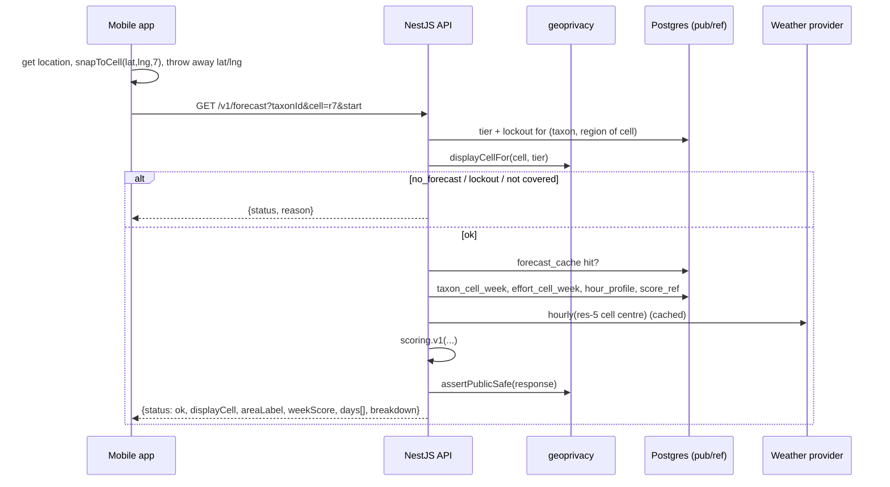
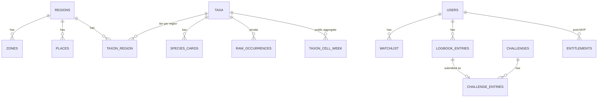
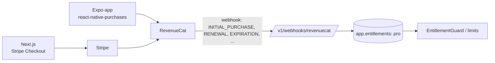
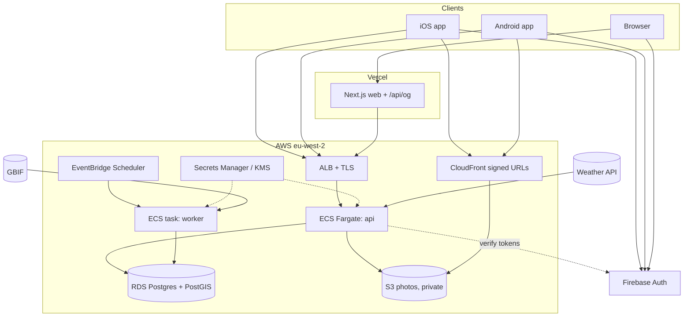

# WildWindow: Architecture and Tech Plan (MVP v1)

|         |                                                                      |
| ------- | -------------------------------------------------------------------- |
| Status  | Draft v1.0, 17 Nov 2026                                              |
| Related | [PRD.md](PRD.md), [TASKS.md](TASKS.md), [../AGENTS.md](../AGENTS.md) |

This document is the source of truth for technical decisions. If the code and this document disagree,
fix one of them in the same pull request. Section numbers (§) are referenced from TASKS.md and AGENTS.md.

---

## 1. Principles

1. **Privacy by construction.** Precise coordinates sit in a database schema that the API cannot read. Public outputs are built only from aggregated, tier-resolution cells (§5).
2. **Licence-clean data.** Every record carries its licence. Ingestion drops anything outside the allowlist (§3).
3. **Explainable score.** Score v1 is a transparent heuristic with versioned weights. There is no black-box ML (§4).
4. **Solo-founder friendly.** One language (TypeScript), one database (Postgres + PostGIS), one monorepo, managed services where possible.
5. **Pure core, thin edges.** Scoring and geoprivacy are pure TypeScript packages with no I/O, so they are easy to test and easy to open-source.

## 2. Stack decisions

### 2.1 Summary

| Layer            | Choice                                                                                                                                                                                  | Why                                                                                                               |
| ---------------- | --------------------------------------------------------------------------------------------------------------------------------------------------------------------------------------- | ----------------------------------------------------------------------------------------------------------------- |
| Monorepo         | **pnpm workspaces + Turborepo**                                                                                                                                                         | Fast, cached builds; standard for TS monorepos; Expo supports pnpm (set `node-linker=hoisted` for React Native)   |
| Language         | **TypeScript (strict)** everywhere                                                                                                                                                      | One language across mobile, web, API and jobs                                                                     |
| Mobile           | **Expo (React Native), Expo Router**, TanStack Query, i18next, react-native-maps, react-native-svg                                                                                      | Founder's core skill; EAS Build/Submit/Update; one codebase for iOS and Android                                   |
| Web              | **Next.js (App Router)**, Tailwind CSS, `next/og` for share cards                                                                                                                       | SEO species pages, public pledge page, admin, image cards                                                         |
| Backend API      | **NestJS** (REST, OpenAPI), validated with Zod (`nestjs-zod`)                                                                                                                           | See §2.2                                                                                                          |
| Database         | **PostgreSQL 17 + PostGIS 3.5** (Docker image `postgis/postgis:17-3.5`), **Drizzle ORM**                                                                                                | Spatial queries, schemas and roles for privacy isolation; Drizzle supports PostGIS geometry columns and plain SQL |
| Spatial index    | **H3** (`h3-js`) cell IDs stored as text, plus PostGIS geometry for boundaries                                                                                                          | Deterministic hierarchical cells suit privacy snapping (§5)                                                       |
| Jobs             | **`apps/worker`** Node CLI (run with `tsx`), started on a schedule in prod                                                                                                              | Simple. No queue needed in the MVP.                                                                               |
| Auth             | **Firebase Authentication** (identity only), with tokens checked in NestJS by `firebase-admin`                                                                                          | Founder knows it; Apple and Google sign-in; free to start; user data stays in Postgres                            |
| Storage          | **S3** (private bucket) + CloudFront signed URLs; a local filesystem driver in dev                                                                                                      | Photos for the logbook and challenge                                                                              |
| Payments (later) | **RevenueCat** (iOS/Android in-app purchases) + **Stripe** (web), one `pro` entitlement                                                                                                 | §9                                                                                                                |
| Hosting          | **AWS eu-west-2 (London)**: ECS Fargate (API, scheduled worker), RDS PostgreSQL, S3, CloudFront. **Vercel** for Next.js. **EAS** for mobile.                                            | Close to the UK paying market and fits UK GDPR. Founder knows AWS and Docker.                                     |
| Observability    | Sentry (errors), PostHog EU (product analytics with no location properties), CloudWatch logs                                                                                            |                                                                                                                   |
| Testing          | **Vitest** (packages, api, worker, web), **jest-expo** + React Native Testing Library (mobile), **fast-check** property tests (geoprivacy, scoring), Playwright (web smoke tests later) |                                                                                                                   |
| Lint and format  | ESLint (flat config, `typescript-eslint` strict), Prettier                                                                                                                              |                                                                                                                   |

### 2.2 Backend: NestJS + Postgres/PostGIS, not Firebase

**Decision: NestJS API on Postgres + PostGIS.** Firebase is used for authentication only.

| Need                                                               | NestJS + PostGIS                                            | Firebase (Firestore + Functions)                                     |
| ------------------------------------------------------------------ | ----------------------------------------------------------- | -------------------------------------------------------------------- |
| Spatial aggregation (cells, k-rings, polygons, millions of points) | Native SQL and PostGIS, plus batch jobs                     | No real spatial queries; you need geohash workarounds                |
| Privacy isolation (the API _cannot_ read raw coordinates)          | Postgres schemas and roles enforce it at the database level | Security rules apply to clients, not to server code; harder to prove |
| One choke point for public outputs (§5.6)                          | A global interceptor and a single response schema layer     | Spread across functions                                              |
| Batch ingestion and aggregation of GBIF downloads                  | SQL `COPY` and set-based aggregation                        | Slow and costly per-document writes                                  |
| Licence filtering and attribution joins                            | Relational joins                                            | Denormalised and awkward                                             |
| Vendor lock-in                                                     | Low (Docker + Postgres run anywhere)                        | High                                                                 |

Firebase would be faster for the first CRUD screens, but the core of this product (geo aggregation and provable privacy) is relational and spatial. Using Firebase Auth alone keeps the fast sign-in setup without that trade-off.

## 3. Data sources and ingestion

### 3.1 Source policy

| Source               | Status                                                                                                                                                                     | How it's used                                                                                                                                                                                                                  | Licence rule                                                                                                                                | Config flag                                                                            |
| -------------------- | -------------------------------------------------------------------------------------------------------------------------------------------------------------------------- | ------------------------------------------------------------------------------------------------------------------------------------------------------------------------------------------------------------------------------ | ------------------------------------------------------------------------------------------------------------------------------------------- | -------------------------------------------------------------------------------------- |
| **GBIF occurrences** | **Primary**                                                                                                                                                                | Async **download API** (`SIMPLE_CSV`) with a predicate: taxon keys, country or region polygon, `HAS_COORDINATE`, no geospatial issues, `BASIS_OF_RECORD` in {HUMAN_OBSERVATION, MACHINE_OBSERVATION, OBSERVATION}, year ≥ 2005 | **Allowlist: `CC0_1_0`, `CC_BY_4_0`.** Filter in the predicate (`LICENSE`) and check again row by row. Store the download DOI for citation. | `GBIF_ENABLED=true`                                                                    |
| iNaturalist          | Comes in through GBIF (the iNaturalist research-grade dataset)                                                                                                             | No direct calls in the MVP                                                                                                                                                                                                     | If the direct API is ever used: ≤ 1 request/s and ≤ 10,000/day, and **no AI or ML training** on its data or images                          | `INAT_DIRECT_ENABLED=false`                                                            |
| eBird                | **Off**                                                                                                                                                                    | None until Cornell gives written permission                                                                                                                                                                                    | The API is non-commercial only                                                                                                              | `EBIRD_ENABLED=false` (the code path throws if enabled without `EBIRD_PERMISSION_REF`) |
| Weather              | Provider interface (§3.4)                                                                                                                                                  | Hourly forecast at **cell centre** coordinates                                                                                                                                                                                 | Check commercial terms before production                                                                                                    | `WEATHER_PROVIDER=metno\|openmeteo`                                                    |
| Tides                | Provider interface (§3.5)                                                                                                                                                  | Coastal species only                                                                                                                                                                                                           | Check licence and pricing per provider                                                                                                      | `TIDE_PROVIDER=none\|...`                                                              |
| Sun position         | `suncalc` library (BSD-2-Clause), on the device and on the server                                                                                                          | Golden hour, blue hour, sunrise and sunset                                                                                                                                                                                     | Open source                                                                                                                                 | n/a                                                                                    |
| Place names          | GeoNames (CC BY 4.0) places for GB-Scotland and PK-Sindh                                                                                                                   | Place search, area labels                                                                                                                                                                                                      | Attribution                                                                                                                                 | n/a                                                                                    |
| Boundaries           | Natural Earth (public domain) for region polygons; Scotland council areas and Sindh districts for **labels only** (check each source's licence, for example geoBoundaries) | Region coverage, area labels                                                                                                                                                                                                   | Per source                                                                                                                                  | n/a                                                                                    |

> **Never hardcode GBIF taxon keys or dataset licences from memory.** Look up taxon keys with the GBIF species match API (`/v1/species/match`) and store them in the seed file with the lookup date.

### 3.2 Ingestion pipeline

```mermaid
flowchart LR
  subgraph Config
    BS[data/beta-species.yaml]
    SS[data/sensitive-species.yaml]
    EG[effort groups: Aves, Mammalia, ...]
  end
  BS --> REQ
  EG --> REQ
  REQ[worker: gbif:request<br/>build predicate + licence allowlist] -->|POST /occurrence/download/request| GBIF[(GBIF)]
  GBIF -->|poll until SUCCEEDED| DL[worker: gbif:fetch<br/>download zip + DOI]
  DL --> PARSE[stream-parse SIMPLE_CSV]
  PARSE --> VAL{validate row<br/>licence in allowlist?<br/>coords ok? uncertainty ok?}
  VAL -- reject --> REJ[ingest_runs.rejected_* counters]
  VAL -- target species --> RAW[(raw.occurrences<br/>precise point, hashed observer)]
  VAL -- effort-only row --> EFF[effort aggregation in memory<br/>never stored raw]
  RAW --> AGG[worker: aggregate<br/>per tier resolution + week]
  EFF --> AGGE[(pub.effort_cell_week)]
  SS --> AGG
  AGG --> GP[@wildwindow/geoprivacy<br/>delay, min-count, merge-to-parent]
  GP --> PUB[(pub.taxon_cell_week)]
  RAW --> HOUR[(pub.taxon_hour_profile)]
  PUB --> REF[worker: score:refs<br/>rr_ref P95 per taxon/region]
  REF --> PUBREF[(pub.taxon_score_ref)]
```

**Steps** (each one is a worker command; see AGENTS.md for how to run them):

1. `gbif:request --region scotland|sindh --kind target|effort`. Builds the predicate:
   - `target`: `TAXON_KEY in [beta species keys]`, plus a `GEOMETRY` (region WKT, simplified) or `COUNTRY` (GB) / `GADM_GID` (Sindh), `LICENSE in [CC0_1_0, CC_BY_4_0]`, `HAS_COORDINATE=true`, `HAS_GEOSPATIAL_ISSUE=false`, the `BASIS_OF_RECORD` set and `YEAR >= 2005`.
   - `effort`: the same filters, but with the **effort group** taxon keys (for example class Aves for birds, class Mammalia for mammals), which are used as the sampling-effort proxy.
   - It saves an `ingest_runs` row with the GBIF download key. Credentials: `GBIF_USER`, `GBIF_PASSWORD`, `GBIF_EMAIL`.
2. `gbif:fetch --run <id>`. Polls the download status and downloads the zip when it succeeds. Records the DOI and the total record count.
3. `gbif:load --run <id>`. Stream-parses the TSV (do not load it all into memory) and checks each row:
   - `license` ∈ allowlist, otherwise it counts towards `rejected_licence`;
   - coordinates are present, inside the region polygon, and `coordinateUncertaintyInMeters` ≤ 1,000 m for res-7 use (≤ 10,000 m for res-5/4-only use; a missing value counts as 1,000 m);
   - `eventDate` can be parsed. Week of year is ISO 1–52 (week 53 merges into 52). The hour is set only when `eventDate` has a time **and** that time is not `00:00` (often a placeholder);
   - the observer comes from `recordedBy`, normalised, as `observer_hash = HMAC-SHA256(OBSERVER_HASH_SALT, value)`. The raw name is never stored.
   - Target rows are bulk-inserted into `raw.occurrences` with `COPY` (deduplicated on `source, source_record_id`). Effort rows are counted straight into the `(res, cell, week)` maps and upserted into `pub.effort_cell_week`.
4. `aggregate --region <slug>`. For each taxon it reads the tier from `ref.taxon_region.tier`, then:
   - drops records younger than the tier's `delayDays`;
   - counts records and distinct observers per `(tier resolution cell, week)`;
   - runs `suppressAndMerge` (§5.4), then writes `pub.taxon_cell_week` (and the region totals in `pub.taxon_region_week`);
   - builds `pub.taxon_hour_profile` (24 bins per taxon and region, local time, from rows that have an hour).
5. `score:refs --region <slug>`. Works out `rr_ref` (the P95 of reporting rate across published cells and weeks) per taxon and region (§4.2).
6. `backtest --region <slug> --holdout <year>`. Writes a Markdown report to `reports/backtest-<region>-<year>.md` (PRD S6).

**Schedule (prod):** a monthly full refresh per region (GBIF downloads are snapshots), plus `aggregate` and `score:refs` after every load. Re-running is safe: aggregation rebuilds `pub.*` tables for the region inside one transaction.

> GBIF also has an SQL download API that can return grid aggregates. It might replace the effort download later; look into it in a later phase. The MVP uses `SIMPLE_CSV`.

### 3.3 Species and sensitivity config

- `data/beta-species.yaml`: about 40–60 species across both regions. Each entry has the scientific name, common names (en, ur), group, `gbifTaxonKey` (filled in by a script), `regions`, `coastal`, `tidePref`, `activityPattern` (`diurnal|crepuscular|nocturnal|tidal`), and `challengeEligible`.
- `data/sensitive-species.yaml`: tier per `(taxon, region)`, breeding lockout months, the reviewer and the review date. **Default rule:** a species missing from the file is `open` only if it is on the beta list, has no IUCN threatened status recorded in our seed, and is not on Scotland's Schedule 1. Otherwise it is `protected`. When in doubt, choose the higher tier.
- Starting tiers must match the PRD §9.2 examples (for example Capercaillie is `no_forecast` in Scotland; Osprey and white-tailed eagle are `highly_protected` with breeding lockout; Eurasian otter and mountain hare are `protected`; green turtle in Sindh is `highly_protected` with a nesting lockout; Indus river dolphin and smooth-coated otter are `protected`).
- `data/species-cards/<region>/<slug>.md`: curated field cards with front-matter (`reviewedBy`, `reviewedAt`). These are loaded into `ref.species_cards`.

### 3.4 Weather provider

```ts
interface WeatherProvider {
  id: 'metno' | 'openmeteo';
  hourly(lat: number, lng: number, fromUtc: Date, hours: number): Promise<HourlyWeather[]>;
}
type HourlyWeather = {
  timeUtc: string;
  precipProb: number /*0..1*/;
  precipMm: number;
  windKph: number;
  cloudPct: number;
};
```

- **Default for production: MET Norway Locationforecast (`api.met.no`).** It is global and its data is openly licensed for commercial use with attribution. It requires an identifying `User-Agent` and caching that respects `Expires` / `If-Modified-Since`. **Check the current terms before launch.** Note: MET Norway gives a precipitation amount everywhere but precipitation _probability_ only in some areas. When the probability is missing, derive `precipProb` from the amount (for example `min(1, precipMm / 2)`) and document it.
- **Open-Meteo:** for development and tests only, unless a commercial plan is bought (the free tier is non-commercial).
- Always call the provider with the **res-5 cell centre** (never the user's position), and cache in `pub.weather_cache` with a TTL of the provider's `Expires` value or 1 hour.

### 3.5 Tide provider

```ts
interface TideProvider {
  id: string;
  extremes(lat: number, lng: number, fromUtc: Date, days: number): Promise<TideExtreme[]>;
}
type TideExtreme = { timeUtc: string; type: 'high' | 'low'; heightM?: number };
```

- The MVP ships `NoTideProvider`, so tide shows as "Not used" for every species.
- A later task adds a real provider for Scotland. Candidates are the UK Hydrographic Office Admiralty Tidal API, WorldTides and Stormglass. **Check the licence, coverage (Karachi too) and pricing before choosing.** Only coastal species (`coastal: true` with a `tidePref`) use tide.

## 4. Scoring algorithm v1 (Window score)

All weights live in `packages/scoring/src/config/v1.ts` and are exported as `SCORING_V1`. Every forecast response includes `scoringVersion: "1.0"`. Changing any weight bumps the version.

### 4.1 Definitions

- `s` = taxon, `R` = region.
- `c` = **display cell**: the user's res-7 cell, moved up to the tier's resolution (`open` res 7, `protected` res 5, `highly_protected` res 4). See §5.
- `d` = date (region local time zone). `w(d)` = ISO week 1–52.
- `W±1(d)` = weeks `{w-1, w, w+1}`, wrapping around the year.
- `N(c)` = the neighbourhood: `kRing(c, 1)` for res 7, and `{c}` for res 5 and res 4.

### 4.2 Factors (each in [0, 1])

**H: Seasonality and local history** (effort-normalised reporting rate, shrunk towards the region)

```
n_s   = Σ pub.taxon_cell_week.n_records   over cells N(c), weeks W±1(d)
n_e   = Σ pub.effort_cell_week.n_records  over the same cells and weeks (effort group of s)
R_reg = Σ_region n_s / Σ_region n_e        over weeks W±1(d)
rr    = (n_s + α · R_reg) / (n_e + α)      α = 20
H     = min(1, rr / rr_ref(s, R))          rr_ref = P95 of rr over all published cells and weeks
```

If the region-week has no effort (`Σ_region n_e = 0`), then `H = 0` and confidence is Low.

**T: Time of day**, for a 2-hour block `b` starting at local hour `h`

```
p(h) = smoothed hourly share from pub.taxon_hour_profile (circular kernel [0.25, 0.5, 0.25])
       if the profile has < 30 timed records, use the template for activityPattern instead
T_b  = (p(h) + p(h+1)) / max over candidate blocks of (p(h') + p(h'+1))
```

The candidate blocks are 2-hour blocks starting on the hour, between civil dawn and civil dusk (sun altitude ≥ −6°).

**G: Light**

```
golden hour = sun altitude between −4° and +6° (computed with suncalc for the cell centre)
G_b = 0.5 + 0.5 · (fraction of block b inside golden hour)
```

**Wx: Weather** (hourly values inside block `b`)

```
f_rain = 1 − 0.6 · max(precipProb)
f_wind = 1                          if max(windKph) ≤ 20
       = 1 − 0.5 · (V − 20) / 30    if 20 < V < 50
       = 0.5                        if V ≥ 50
Wx_b   = f_rain · f_wind
```

Beyond the provider's forecast horizon, `Wx_b = 0.85` (neutral) and the breakdown flags it as `weather: "no_forecast_yet"`.

**D: Tide** (only when the species has `tidePref` and the tide provider returned data)

```
preferred window: low = ±2 h around low tide; high = ±2 h around high tide;
                  rising = from low to high; falling = from high to low
D_b = 1.0 if block b overlaps the preferred window, else 0.6
D_b = 1.0 and the factor is marked "not_used" otherwise
```

### 4.3 Combining

```
C_b        = (0.6 + 0.4·T_b) · (0.7 + 0.3·G_b) · Wx_b · D_b          // conditions; C_b ≤ 1
DayScore_d = round(100 · sqrt(H_d) · max_b C_b)                      // 0..100
BestBlock_d = argmax_b C_b
WeekScore  = max_d DayScore_d over the 7 requested days;  BestDay = argmax
```

Why: `sqrt(H)` stops rare-but-present species from always scoring near zero. The conditions can only _reduce_ the history-based score; good weather alone can never make an absent species score well.

### 4.4 Confidence

| Label  | Rule (for `c`'s neighbourhood, weeks W±1, all years)                             |
| ------ | -------------------------------------------------------------------------------- |
| High   | `n_s ≥ 50` and data from ≥ 3 distinct years and `n_e ≥ 500`                      |
| Medium | `n_s ≥ 15` and ≥ 2 distinct years                                                |
| Low    | otherwise. The response includes `range: [max(0, score−15), min(100, score+15)]` |

### 4.5 Status overrides (checked before scoring)

| Condition                                                   | Response `status` | Score fields        |
| ----------------------------------------------------------- | ----------------- | ------------------- |
| Tier `no_forecast`                                          | `unavailable`     | null                |
| Tier `highly_protected` and `d` falls in the lockout months | `lockout`         | null, with `reason` |
| Cell outside the beta regions                               | `not_covered`     | null                |
| Otherwise                                                   | `ok`              | filled in           |

### 4.6 Worked example (illustrative numbers only)

Common kingfisher (`open`, res 7), a Glasgow cell, a week in October: `n_s = 42`, `n_e = 3,100`, `R_reg = 0.011` → `rr = (42 + 0.22)/(3,120) = 0.0135`. With `rr_ref = 0.020`, `H = 0.68` and `sqrt(H) = 0.82`. On Saturday the best block 07:00–09:00 has `T = 0.9`, `G = 0.75`, `Wx = 0.94` and `D = 1` (tide not used), so `C = 0.96 · 0.925 · 0.94 = 0.835` and **DayScore = round(100 · 0.82 · 0.835) = 69**. Confidence is Medium if there is data from only 2 years.

### 4.7 Validation (backtest)

`backtest` computes weekly `H` per published cell using years `Y−10 … Y−2`, then compares it with the held-out year `Y−1`. The pass rule (PRD §8): in the held-out year, top-quartile weeks have ≥ 2× the reporting rate of bottom-quartile weeks. It is reported per species.

## 5. Location protection (`@wildwindow/geoprivacy`, MIT)

`packages/geoprivacy` is a pure TypeScript package that depends only on `h3-js`. It is published as open source. It holds the **policy constants** and **functions**. Which species get which tier is data, kept in `data/sensitive-species.yaml`.

### 5.1 Tier policy (must match PRD §9.2)

```ts
export const TIER_POLICY = {
  open: {
    resolution: 7,
    kRing: 1,
    delayDays: 0,
    minRecords: 5,
    minObservers: 3,
    lockout: false,
    mapCells: true,
  },
  protected: {
    resolution: 5,
    kRing: 0,
    delayDays: 30,
    minRecords: 10,
    minObservers: 5,
    lockout: 'optional',
    mapCells: true,
  },
  highly_protected: {
    resolution: 4,
    kRing: 0,
    delayDays: 365,
    minRecords: 20,
    minObservers: 8,
    lockout: true,
    mapCells: false,
  },
  no_forecast: {
    resolution: null,
    kRing: 0,
    delayDays: 0,
    minRecords: Infinity,
    minObservers: Infinity,
    lockout: true,
    mapCells: false,
  },
} as const;
```

Approximate H3 average cell areas: res 7 ≈ 5 km², res 5 ≈ 250 km², res 4 ≈ 1,770 km². For comparison, iNaturalist obscures sensitive species inside a 0.2° × 0.2° box.

### 5.2 Public API of the package

```ts
snapToCell(lat: number, lng: number, res = 7): string           // used on the device; deterministic
displayCellFor(userCellR7: string, tier: Tier): string | null    // cellToParent at the tier's resolution; null for no_forecast
suppressAndMerge(cells: CellCount[], tier: Tier): CellCount[]    // §5.4
isInLockout(date: Date, months: number[], timeZone: string): boolean
isOlderThanDelay(eventDate: Date, now: Date, tier: Tier): boolean
bucketise(values: number[], buckets = 5): (v: number) => 1|2|3|4|5   // public maps get levels, not counts
assertPublicSafe(payload: unknown, opts: { maxResolutionByTier, allowOwnerLocation?: boolean }): void
```

### 5.3 Threats and mitigations

| Threat                                                       | Mitigation                                                                                                                                                                                                                                                                                    |
| ------------------------------------------------------------ | --------------------------------------------------------------------------------------------------------------------------------------------------------------------------------------------------------------------------------------------------------------------------------------------- |
| Reading exact points from an API                             | Raw points live only in `raw.*`. The API database role has **no privileges** on schema `raw` (§6.3).                                                                                                                                                                                          |
| Averaging out random jitter with repeated queries            | No jitter. Snapping is deterministic, so repeated queries return the same coarse cell.                                                                                                                                                                                                        |
| Differential queries over nearby cells                       | Outputs depend only on the **display cell** (the parent at the tier's resolution), so every child cell gets an identical response.                                                                                                                                                            |
| Small-count re-identification                                | Minimum records and minimum distinct observers per cell. Failing cells merge into their parent, or are suppressed.                                                                                                                                                                            |
| Freshness leaks (a nest found yesterday)                     | A per-tier delay on records, plus breeding-season lockout for `highly_protected`.                                                                                                                                                                                                             |
| Cross-record leaks from one user (the iNaturalist complaint) | User content is never published with a location finer than country and region. Logbooks never feed public aggregates in the MVP.                                                                                                                                                              |
| Photo metadata leaks                                         | GPS EXIF is stripped on the device, and the server rejects or re-strips any upload that still has GPS.                                                                                                                                                                                        |
| Count leaks on maps                                          | Public maps show 1–5 levels (quantile buckets), not counts, for every tier.                                                                                                                                                                                                                   |
| Developer mistakes                                           | A global `PublicGeoInterceptor` calls `assertPublicSafe`, which throws on the keys `lat`, `lng`, `latitude`, `longitude`, `coordinates`, `geom`, `point`, `wkt`, and on any H3 cell finer than the tier allows. Owner-only routes opt out with `@OwnerLocation()`. Property tests cover this. |

### 5.4 `suppressAndMerge` algorithm

```
input: cells at the tier's resolution r with (nRecords, nObservers)
repeat:
  failing = cells where nRecords < minRecords or nObservers < minObservers
  if none fail: break
  group the failing cells by parent at r−1; sum the counts (observers: count distinct hashes, worked out upstream per parent)
  replace the failing cells with their parent aggregates (keeping the passing siblings as they are)
  r = r − 1; stop at the region's minimum resolution (res 3), and drop anything still failing
output: a set of cells, possibly at mixed resolutions, each ≥ the minimums
```

To count distinct observers correctly, the worker passes a `Set<observer_hash>` per cell into the merge step. The hashes never leave the worker.

### 5.5 Sequence: forecast request



### 5.6 Rule for all public outputs

All public responses go through one serialiser per endpoint, using Zod schemas from `packages/shared` that **have no coordinate fields**, plus `PublicGeoInterceptor`. Any new endpoint that returns geography needs a geoprivacy test.

## 6. Data model

### 6.1 Postgres schemas

| Schema | Contents                                                     | Who can read it                                        |
| ------ | ------------------------------------------------------------ | ------------------------------------------------------ |
| `raw`  | Precise occurrence points (private)                          | `ww_worker` only                                       |
| `ref`  | Taxa, regions, zones, places, datasets, cards, tiers         | API (read), worker (read/write), admin through the API |
| `pub`  | Aggregated, policy-applied tables safe to serve, plus caches | API (read; write caches), worker (write)               |
| `app`  | Users, watchlist, logbook, challenges, entitlements, audit   | API (read/write)                                       |

### 6.2 Tables (MVP)

```text
ref.regions            id, slug ('scotland'|'sindh'), name, country_code, time_zone, geom MULTIPOLYGON(4326), min_res
ref.zones              id, region_id, name, kind ('council_area'|'district'), geom MULTIPOLYGON   -- labels only
ref.places             id, region_id, name, alt_names text[], kind, cell_r7, population   -- GeoNames
ref.taxa               id, gbif_taxon_key UNIQUE, scientific_name, common_names jsonb {en, ur}, group,
                       effort_group, coastal bool, tide_pref, activity_pattern, challenge_eligible
ref.taxon_region       taxon_id, region_id, tier, lockout_months int[], reviewer, reviewed_at  PK(taxon_id, region_id)
ref.species_cards      id, taxon_id, region_id, body_md, settings jsonb, ethics_md, legal_md,
                       status ('draft'|'reviewed'), reviewed_by, reviewed_at
ref.datasets           gbif_dataset_key PK, title, publisher, license, citation
raw.occurrences        id bigserial, source, source_record_id, taxon_id, region_id, geom POINT(4326),
                       uncertainty_m, event_date date, year, week, hour NULL, license, dataset_key,
                       observer_hash, ingest_run_id   UNIQUE(source, source_record_id)   GIST(geom)
app.ingest_runs        id, source, region_id, kind ('target'|'effort'), gbif_download_key, doi, status,
                       total, loaded, rejected_licence, rejected_coords, rejected_other, started_at, finished_at
pub.taxon_cell_week    taxon_id, region_id, res, cell, week, n_records, n_observers, years_covered, updated_at
                       PK(taxon_id, res, cell, week)
pub.taxon_region_week  taxon_id, region_id, week, n_records, n_effort
pub.effort_cell_week   effort_group, region_id, res, cell, week, n_records  PK(effort_group, res, cell, week)
pub.taxon_hour_profile taxon_id, region_id, hour 0..23, n_records
pub.taxon_score_ref    taxon_id, region_id, rr_ref, computed_at, scoring_version
pub.weather_cache      provider, cell_r5, fetched_at, expires_at, payload jsonb
pub.forecast_cache     taxon_id, display_cell, start_date, scoring_version, payload jsonb, expires_at
app.users              id uuid, firebase_uid UNIQUE, display_name, home_region_id, locale, role ('user'|'admin'),
                       created_at, deleted_at
app.watchlist          id, user_id, taxon_id, cell_r7, created_at   UNIQUE(user_id, taxon_id, cell_r7)
app.logbook_entries    id, user_id, taxon_id NULL, taken_at, cell_r7 NULL, exact_point_enc bytea NULL,
                       photo_key, thumb_key, exif jsonb (no GPS), notes, created_at, updated_at
app.challenges         id, slug, title, taxon_id, starts_on, ends_on, rules_md, status ('draft'|'live'|'closed')
app.challenge_entries  id, challenge_id, user_id, logbook_entry_id, country_code, region_label, photo_key,
                       pledge_accepted_at, status ('pending'|'approved'|'rejected'), reject_reason,
                       publish_after (submitted + 7 days), created_at
app.entitlements       user_id, entitlement ('pro'), source ('revenuecat'|'stripe'), expires_at   -- post-MVP
app.waitlist           id, email UNIQUE, region_slug NULL, source, created_at          -- W-01 landing page
app.audit_log          id, actor_user_id, action, entity, entity_id, before jsonb, after jsonb, created_at
```



### 6.3 Database roles (created by migration)

- `ww_owner`: owns all objects and runs migrations.
- `ww_worker`: `USAGE, SELECT, INSERT, UPDATE, DELETE` on `raw`, `pub` and `ref`; `INSERT, UPDATE` on `app.ingest_runs`.
- `ww_api`: **no `USAGE` on schema `raw`**; `SELECT` on `ref` and `pub`; `INSERT/UPDATE/DELETE` on `pub.*_cache`; full DML on the `app` tables. An integration test connects as `ww_api` and checks that `SELECT * FROM raw.occurrences` fails.
- Logbook `exact_point_enc` is encrypted with AES-256-GCM in the app. The key comes from `LOGBOOK_ENC_KEY` (dev) or an AWS KMS data key (prod).

## 7. API (NestJS, REST, `/v1`, OpenAPI at `/docs` in non-prod)

All request and response schemas are Zod schemas in `packages/shared/src/api/*`. A typed client in `packages/shared/src/client` is used by mobile and web through TanStack Query.

| Method    | Path                                                                     | Auth         | Description                                                                               |
| --------- | ------------------------------------------------------------------------ | ------------ | ----------------------------------------------------------------------------------------- |
| GET       | `/v1/health`                                                             | -            | Liveness and DB check                                                                     |
| GET       | `/v1/regions`                                                            | -            | Beta regions (no geometry)                                                                |
| GET       | `/v1/regions/:slug/species?q=&group=`                                    | -            | Species list with tier badge                                                              |
| GET       | `/v1/species/:taxonId?region=`                                           | -            | Species detail and the reviewed card                                                      |
| GET       | `/v1/species/:taxonId/seasonality?region=`                               | -            | 52 values in [0, 1] (region level, effort-normalised)                                     |
| GET       | `/v1/species/:taxonId/map?region=`                                       | -            | Public cells at the tier's resolution with level 1–5. Returns `[]` when `mapCells=false`. |
| GET       | `/v1/places?q=&region=`                                                  | -            | Place search, returning `{id, name, regionSlug, cellR7}`                                  |
| GET       | `/v1/areas/:cellR7`                                                      | -            | Area label, region, coverage status                                                       |
| GET       | `/v1/forecast?taxonId=&cell=&start=`                                     | -            | 7-day forecast (§4), with status overrides                                                |
| GET       | `/v1/attributions`                                                       | -            | Datasets, DOIs, providers                                                                 |
| POST      | `/v1/waitlist`                                                           | -            | Join the waitlist `{email, regionSlug?}` (rate-limited, double opt-in later)              |
| GET       | `/v1/me` · PATCH `/v1/me`                                                | user         | Profile and settings                                                                      |
| DELETE    | `/v1/me`                                                                 | user         | Account deletion (queued; full deletion within 30 days)                                   |
| POST      | `/v1/me/export`                                                          | user         | Data export job, returns a signed link                                                    |
| GET/POST  | `/v1/me/watchlist` · DELETE `/v1/me/watchlist/:id`                       | user         | Max 3 entries (`WATCHLIST_LIMIT_FREE=3`)                                                  |
| POST      | `/v1/uploads/presign`                                                    | user         | Presigned PUT for a photo (JPEG/HEIC/WebP, max 15 MB)                                     |
| GET/POST  | `/v1/me/logbook` · GET/PATCH/DELETE `/v1/me/logbook/:id`                 | user (owner) | `@OwnerLocation()` routes                                                                 |
| GET       | `/v1/challenges/current` · `/v1/challenges/:slug`                        | -            | Challenge details and counts per country                                                  |
| GET       | `/v1/challenges/:slug/entries?country=&cursor=`                          | -            | Approved entries past `publish_after`                                                     |
| POST      | `/v1/challenges/:slug/entries`                                           | user         | Submit from a logbook entry, with the pledge                                              |
| GET/PATCH | `/v1/admin/species/:taxonId` · `/v1/admin/taxon-region/:taxonId/:region` | admin        | Edit cards and tiers (audit-logged)                                                       |
| GET/PATCH | `/v1/admin/challenge-entries?status=` · `/:id`                           | admin        | Moderation                                                                                |
| GET       | `/v1/admin/ingest-runs`                                                  | admin        | Ingestion status                                                                          |
| POST      | `/v1/webhooks/revenuecat` · `/v1/webhooks/stripe`                        | signature    | **Post-MVP**                                                                              |

Example forecast response (`status: ok`):

```json
{
  "status": "ok",
  "scoringVersion": "1.0",
  "taxonId": "…",
  "tier": "open",
  "displayCell": "871f1d489ffffff",
  "areaLabel": "Glasgow · Kelvin area",
  "timeZone": "Europe/London",
  "weekScore": 69,
  "bestDay": "2026-11-21",
  "confidence": "medium",
  "range": null,
  "days": [
    {
      "date": "2026-11-21",
      "score": 69,
      "bestBlock": { "start": "07:00", "end": "09:00" },
      "factors": {
        "seasonality": 0.68,
        "timeOfDay": 0.9,
        "light": 0.75,
        "weather": 0.94,
        "tide": "not_used"
      },
      "light": { "goldenAm": ["07:31", "08:40"], "goldenPm": ["15:22", "16:31"] }
    }
  ],
  "explanations": [
    "Kingfishers are reported here often in late November",
    "Light rain risk is low on Saturday morning"
  ]
}
```

Cross-cutting: `ThrottlerGuard` (for example 60 requests/min per IP for public routes, which also helps against scraping), request IDs, structured logs that **never** include lat/lng, CORS limited to the web origin, and Helmet.

## 8. Auth

- Firebase Authentication with Apple, Google and email-link providers. On mobile use the Firebase JS SDK with `expo-apple-authentication` and `@react-native-google-signin/google-signin` (needs an EAS development build). Note: Firebase Dynamic Links shut down in 2025, so email-link sign-in on mobile must use the newer Firebase Hosting link setup. If that holds up the MVP, ship Apple + Google first.
- The API's `FirebaseAuthGuard` checks the `Authorization: Bearer <idToken>` header with `firebase-admin` and creates or updates `app.users` on first sight. The admin role comes from `app.users.role` (set by a seed or CLI command), not from client claims.
- Anonymous users can call all public `GET` endpoints.

## 9. Payments (post-MVP, designed now)



- Products: `pro_monthly` ($4.99) and `pro_yearly` ($39.99). No weekly plans. Any free trial is explicit, with a reminder before it bills.
- The RevenueCat `app_user_id` is our `app.users.id`. Stripe purchases are linked through RevenueCat's Stripe integration, so there is one source of truth.
- Free limits: watchlist 3 (already enforced in the MVP). Pro unlocks an unlimited watchlist, alerts, offline packs and the trip planner.

## 10. Repo structure

```text
wildwindow/
├─ apps/
│  ├─ mobile/        Expo app (Expo Router) – screens S-01..S-17
│  ├─ web/           Next.js – W-01..W-07, /api/og share cards, admin
│  ├─ api/           NestJS REST API (§7)
│  └─ worker/        Ingestion and aggregation CLI (§3.2)
├─ packages/
│  ├─ shared/        Zod API schemas, types, constants, typed API client
│  ├─ db/            Drizzle schema, SQL migrations (PostGIS, roles), seed scripts
│  ├─ geoprivacy/    @wildwindow/geoprivacy (MIT, publishable) – §5
│  ├─ scoring/       Window score v1, light (suncalc), provider interfaces – §4
│  └─ config/        tsconfig, eslint and prettier presets
├─ data/
│  ├─ beta-species.yaml
│  ├─ sensitive-species.yaml
│  └─ species-cards/{scotland,sindh}/*.md
├─ infra/            AWS CDK (TypeScript) – Phase 9
├─ reports/          Generated backtest reports
├─ docs/             PRD, ARCHITECTURE, TASKS
├─ docker-compose.yml  PostGIS for local dev
├─ AGENTS.md
├─ CURSOR_PROMPT.md
├─ turbo.json · pnpm-workspace.yaml · package.json · .env.example
└─ LICENSE (proprietary for the app; packages/geoprivacy/LICENSE is MIT)
```

Dependency rules: `geoprivacy` has no internal dependencies. `scoring` depends on `geoprivacy` (types only). `shared` depends on `geoprivacy` (tier types). `db` depends on nothing internal. `api` and `worker` depend on `db`, `scoring`, `geoprivacy` and `shared`. `mobile` and `web` depend on `shared`, `geoprivacy` (`snapToCell` only) and `scoring` (light helpers only). **Apps never import `raw` tables.** Only `worker` may import `db/raw`.

## 11. Infrastructure and deployment



| Environment  | Setup                                                                                                                                                                                                                                                                                                                          |
| ------------ | ------------------------------------------------------------------------------------------------------------------------------------------------------------------------------------------------------------------------------------------------------------------------------------------------------------------------------ |
| Local        | `pnpm db:up` → Docker `postgis/postgis:17-3.5` on port 5432 (ARCHITECTURE §2). Host Postgres.app / PG 18 without PostGIS is not a substitute; free 5432 or remap the host port. The API, worker and web run with pnpm. Mobile uses an Expo dev build. Local filesystem storage driver. Weather provider `openmeteo` or a mock. |
| CI           | GitHub Actions: install → lint → typecheck → test (with a PostGIS service container) → build. Mobile: `expo-doctor` and jest-expo.                                                                                                                                                                                             |
| Staging/beta | The AWS stack above at its smallest size (single-AZ RDS, 1 API task). Web preview deploys on Vercel. EAS internal distribution and TestFlight.                                                                                                                                                                                 |
| Production   | The same stack. Turn on RDS automated backups and point-in-time recovery, run 2 API tasks, add alarms.                                                                                                                                                                                                                         |

Deploy flow: merging to `main` builds the API and worker Docker images and pushes them to ECR, CDK deploys to staging, and a manual approval promotes to prod. Mobile JS-only changes ship with EAS Update; native changes need a new store build.

## 12. Security checklist (MVP)

- Secrets live only in env vars or Secrets Manager. `.env.example` lists the keys with no values. CI runs `gitleaks`.
- `ww_api` cannot read `raw` (tested). The logbook exact point is encrypted. S3 is private with signed URLs only.
- Uploads: check the MIME type, a 15 MB limit, EXIF GPS stripped (checked on the server with `exifr`), and re-encoding on the server for challenge entries.
- Rate limits on public routes. Admin routes need `role=admin`. The audit log covers tier and card changes.
- Dependencies: Renovate or Dependabot, and `pnpm audit` in CI (warn only).

## 13. Cost notes (no prices given; check current pricing before committing)

| Item                        | What drives the cost                                                                  | How to keep it low in the beta                                                                                                       |
| --------------------------- | ------------------------------------------------------------------------------------- | ------------------------------------------------------------------------------------------------------------------------------------ |
| RDS PostgreSQL              | Instance size, storage, backups, Multi-AZ                                             | Smallest instance, single-AZ for the beta. A managed Postgres with PostGIS (for example Neon or Supabase) is a possible alternative. |
| ECS Fargate                 | vCPU and memory hours; the ALB runs all the time                                      | 1 small API task. The worker runs only on schedule.                                                                                  |
| S3 + CloudFront             | Storage and data out                                                                  | Thumbnails for lists, size-limited uploads                                                                                           |
| Vercel                      | Plan tier, function and image usage                                                   | `next/og` cards cached at the edge                                                                                                   |
| Firebase Auth               | Monthly active users above the free allowance; phone auth is billed (not used)        | No SMS auth                                                                                                                          |
| Weather API                 | Free with attribution (MET Norway; check the terms) vs a commercial plan (Open-Meteo) | Cache per res-5 cell and per hour                                                                                                    |
| Tide API                    | Usually paid per request or plan                                                      | Coastal species only, aggressive caching, off by default                                                                             |
| GBIF                        | Free (attribution and citation needed)                                                | Monthly downloads                                                                                                                    |
| EAS                         | Build minutes and update bandwidth on paid tiers                                      | Use local builds when needed                                                                                                         |
| Sentry / PostHog            | Event volume                                                                          | Sample events; no session replay in the MVP                                                                                          |
| App stores                  | Apple Developer Program yearly fee, Google Play one-time registration fee             | Required                                                                                                                             |
| RevenueCat / Stripe (later) | Percentage fees above free thresholds, plus Apple and Google store commission         | Check the small-business programme rates                                                                                             |
| Domain and email            | Domain registration, AWS SES for transactional email                                  |                                                                                                                                      |
